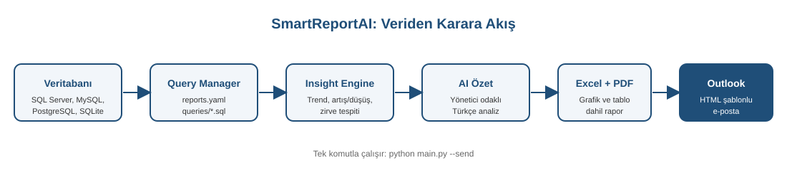
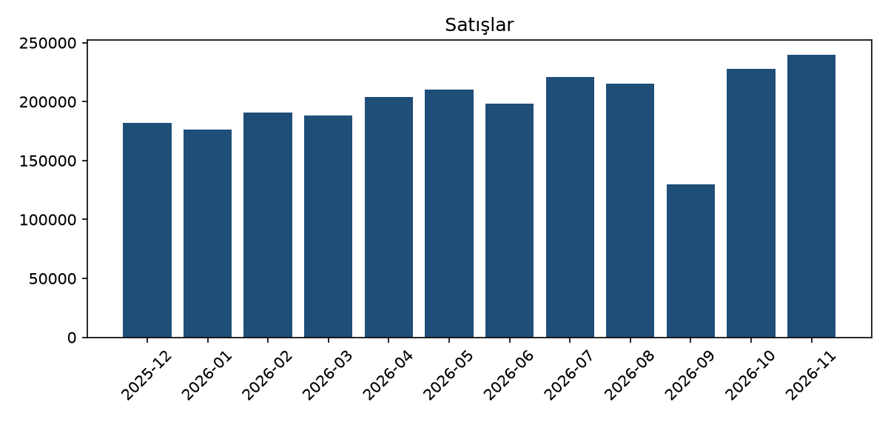
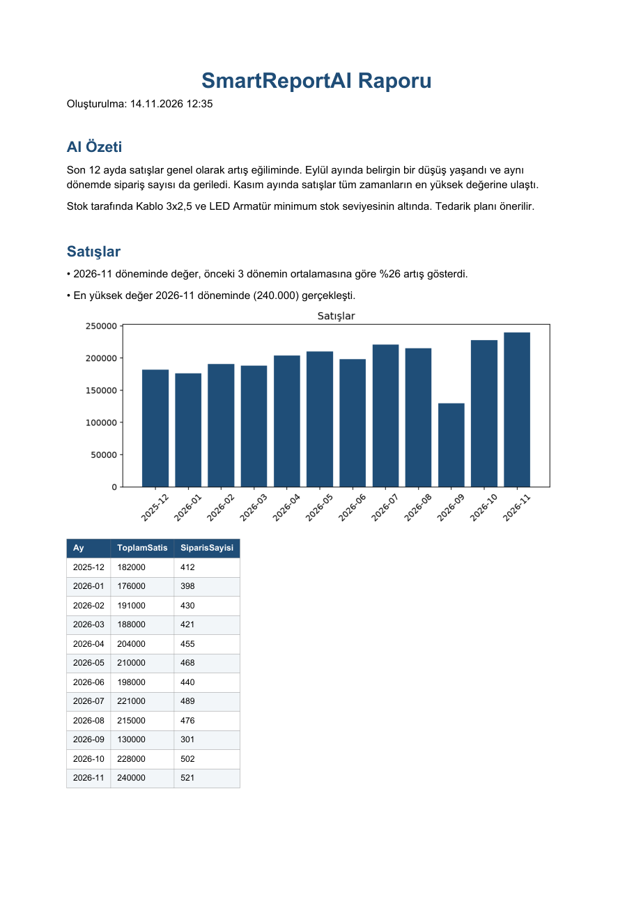

# SmartReportAI: AI-Powered Business Reporting Platform

[](https://www.python.org/)
[](LICENSE)
[](#kurulum)

**SmartReportAI**, SQL Server, MySQL, PostgreSQL ve SQLite verilerinizden otomatik **Excel ve PDF iş raporları** üreten, yapay zeka ile **trend analizi ve yönetici özeti** çıkaran, raporları **Outlook üzerinden e-posta ile** dağıtan açık kaynaklı bir Python platformudur.

Veritabanlarınızdaki iş verisini tek tıkla anlamlı raporlara dönüştürür. Yalnızca veriyi Excel'e aktarmakla kalmaz: veriyi okur, düşüş, artış ve zirve gibi öngörüleri tespit eder, yöneticiler için özet hazırlar ve raporu doğrudan ilgili kişilere iletir.

**Anahtar kelimeler:** otomatik rapor oluşturma, Excel rapor otomasyonu, PDF rapor, SQL Server raporlama, Python raporlama, Outlook otomatik mail, AI iş raporu, yapay zeka özeti, business intelligence, BI otomasyonu, veri öngörüsü, trend analizi, Query Manager.

## Neden SmartReportAI?

- **Veriden karara:** Tablo dökmek yerine "Mart ayında son 3 ayın ortalamasına göre %35 düşüş var, incelenmesi önerilir" gibi öngörüler üretir.
- **Tek kaynak, çoklu veritabanı:** SQL Server, MySQL, PostgreSQL ve SQLite desteği.
- **Kod yazmadan rapor:** Raporlar `config/reports.yaml` ile tanımlanır, SQL dosyaları yeterlidir.
- **Kurumsal çıktı:** Biçimlendirilmiş Excel (grafikli) ve PDF raporları.
- **Otomatik dağıtım:** Outlook üzerinden HTML şablonlu mail gönderimi.

## Akış

```
Veritabanı (SQL Server / MySQL / PostgreSQL / SQLite)
  ↓
Query Manager (reports.yaml + queries/*.sql)
  ↓
DataFrame
  ↓
Insight Engine (trend, düşüş/artış, zirve tespiti)
  ↓
AI Özet (yönetici odaklı Türkçe analiz)
  ↓
Excel + PDF Rapor
  ↓
Outlook Dağıtım (HTML şablon)
```

## Özellikler

| Alan | Durum | Açıklama |
|---|---|---|
| Veri kaynağı | ✅ | SQL Server, MySQL, PostgreSQL, SQLite |
| Query Manager | ✅ | Raporları YAML ile kaydet ve yönet |
| Öngörü motoru | ✅ | Kural tabanlı trend ve anomali tespiti |
| AI özet | ✅ | LLM ile yönetici özeti (OpenAI) |
| Excel çıktısı | ✅ | Biçimlendirilmiş tablo ve yerel Excel grafikleri |
| PDF çıktısı | ✅ | Grafik, öngörü ve tablolu PDF rapor |
| E-posta dağıtımı | ✅ | Outlook, HTML şablon, otomatik ekler |
| Dashboard | 🔜 | KPI kartları ve etkileşimli grafikler (PySide6 / CustomTkinter) |
| Gelişmiş AI öngörüleri | 🔜 | Tahmin modelleri, mevsimsellik ve kök neden analizi |

## Ekran görüntüleri

Aşağıdaki görseller örnek veriyle üretilmiştir.



| Grafik ve öngörüler | PDF rapor önizleme |
|---|---|
|  |  |

## Proje yapısı

```
SmartReportAI/
├── main.py              # Giriş noktası
├── config/
│   ├── settings.py      # .env ayarları
│   ├── connections.yaml # Veritabanı bağlantıları
│   ├── reports.yaml     # Rapor kayıtları (Query Manager)
│   └── loader.py
├── database/            # Veritabanı adaptörleri
│   ├── base.py
│   ├── sqlserver.py
│   ├── mysql.py
│   ├── postgresql.py
│   └── sqlite.py
├── ai/                  # Zeka katmanı
│   ├── insights.py      # Öngörü motoru
│   └── summary.py       # LLM özeti
├── reports/             # Çıktı üreticileri
│   ├── models.py
│   ├── excel_report.py
│   └── pdf_report.py
├── mail/
│   └── outlook.py       # Dağıtım
├── templates/
│   └── email.html       # Mail şablonu
├── queries/             # SQL dosyaları
└── output/              # Üretilen raporlar
```

## Kurulum

Gereksinimler: Windows, Python 3.10+, Microsoft ODBC Driver 17/18 (SQL Server için), Outlook masaüstü uygulaması (dağıtım için).

```bash
pip install -r requirements.txt
copy .env.example .env
```

`.env` dosyasını kendi bağlantı bilgilerinizle doldurun.

## Kullanım

```bash
# Excel + PDF oluştur (output/ klasörüne kaydeder)
python main.py

# Yalnızca Excel
python main.py --formats excel

# Oluştur ve Outlook ile gönder
python main.py --send
```

Windows'ta `SmartReportAI.bat` dosyasına çift tıklayarak da çalıştırabilirsiniz.

## Yeni rapor eklemek

1. `queries/` klasörüne bir `.sql` dosyası ekleyin.
2. `config/reports.yaml` dosyasına kayıt ekleyin:

```yaml
  - name: Giderler
    connection: main_sql      # connections.yaml içindeki bağlantı adı
    query: queries/expenses.sql
    chart: bar                # bar | line | pie | boş
    insights: true            # öngörü analizi yapılsın mı
```

Grafik için SQL'de ilk kolon kategori (ör. ay), ikinci kolon sayısal değer olmalıdır.

## Yeni veritabanı eklemek

1. `config/connections.yaml` içine bağlantıyı ekleyin.
2. `database/` altında `build_url(cfg)` fonksiyonu içeren bir modül oluşturun.
3. `database/base.py` içindeki `URL_BUILDERS` sözlüğüne kaydedin.

## E-posta şablonu

`templates/email.html` dosyasını düzenleyerek mail gövdesini özelleştirebilirsiniz. Kullanılabilir alanlar: `$date`, `$report_names`, `$summary`. Farklı bir şablon için `.env` içinde `MAIL_TEMPLATE` değerini değiştirin.

## Gizlilik notu

Yapay zeka özeti için her raporun ilk 30 satırı OpenAI'ye gönderilir. Hassas veri içeren ortamlarda `OPENAI_API_KEY` boş bırakılarak AI özeti devre dışı bırakılabilir.

## Lisans ve yazar

Bu proje [MIT Lisansı](LICENSE) ile dağıtılmaktadır. Telif hakkı: **RetroNyym**.

## Yol haritası

- [x] Veri → Excel → AI özet → Outlook akışı
- [x] Query Manager
- [x] PDF çıktısı
- [x] Çoklu veritabanı desteği
- [x] E-posta şablonları
- [x] Temel öngörü motoru
- [ ] Dashboard (KPI kartları, etkileşimli grafikler)
- [ ] Gelişmiş AI öngörüleri (tahmin, mevsimsellik, kök neden analizi)
- [ ] Zamanlanmış raporlar
